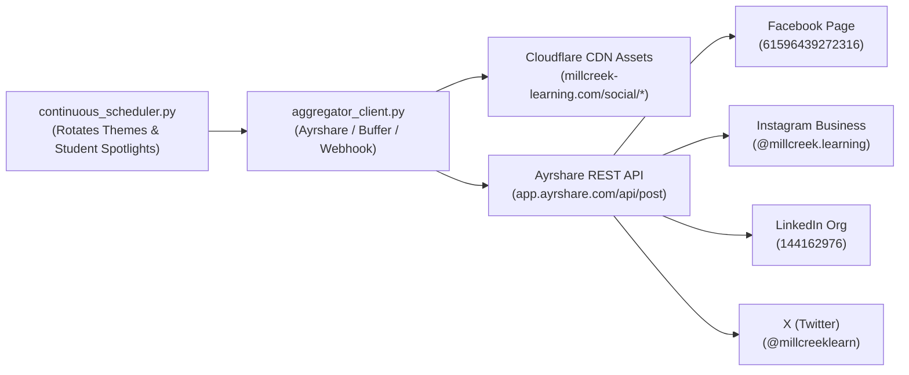

# Route 2: Unified Social Aggregator Continuous Marketing Pipeline

**System Location:** `c:\Users\van\Documents\antigravity\elegant-kepler\campaign_engine`  
**Aggregator Client:** `aggregator_client.py`  
**Drip Scheduler:** `continuous_scheduler.py`  
**Content Matrix:** `marketing_templates.py`  
**Coordinating Agents:** `google-gemini`, `codex/social-promo`, `cursor-auto`, `anthropic-claude`  
**Governance Partner:** AD² Alumni Foundation (EIN: `47-1468217`)  
**Canonical Domain:** https://millcreek-learning.com  

---

## 1. Architecture Overview



---

## 2. Environment Variables & Secret Stores

The client reads from the **Tri-Store Architecture** (Windows Environment, `.env`, Google Secret Manager under `oscar-ai-502220`):

* `AYRSHARE_API_KEY`: Primary API key for multi-channel automated posting.
* `MARKETING_WEBHOOK_URL`: Optional secondary webhook (Make.com, Zapier, n8n).
* `BUFFER_ACCESS_TOKEN`: Optional legacy Buffer aggregator support.

*(Note: When no API key is supplied, the engine operates in `staged_simulation` mode, recording all validated payloads into `state.json` without failing).*

---

## 3. CLI Operations Guide

### Check Current Telemetry & Drip Readiness
```powershell
python -m campaign_engine.continuous_scheduler --status
```

### Preview All 5 Institutional Themes + 12 Student Spotlights
```powershell
python -m campaign_engine.continuous_scheduler --preview-all
```

### Execute a Dry-Run Dispatch (Validates Links & Lengths)
```powershell
python -m campaign_engine.continuous_scheduler --dispatch-next --dry-run
```

### Dispatch the Next Institutional Theme (Live)
```powershell
python -m campaign_engine.continuous_scheduler --dispatch-next
```

### Dispatch the Next Student Cohort Spotlight (Live)
```powershell
python -m campaign_engine.continuous_scheduler --dispatch-next --student-spotlight
```

---

## 4. Child Safeguarding & Narrative Integrity
* **First Names Only**: Kwame, Akosua, Kofi, Ama, Yaw, Esi, Kwesi, Abena, Kojo, Afia, Kwaku, Yaa.
* **No Pity Marketing**: Focus on problem-solving, digital agency, and community building.
* **0% Fee Zeffy Destination**: https://www.zeffy.com/en-US/donation-form/donate-to-change-lives-through-it.
